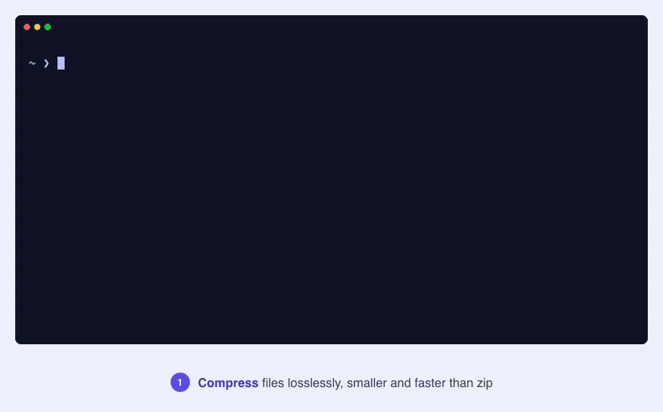

# vaqum

[](https://github.com/marcdomain/vaqum/actions/workflows/ci.yml)

Losslessly compress files 5x faster and 12% smaller output than zip/gzip at defaults (optionally encrypted), decompress them, diff (displayed on editor or HTML report), search and find duplicates, and securely shred them — from the command line.



## Features

| Feature | Command | Highlights |
| --- | --- | --- |
| Compression | `compress` | Lossless, levels 1–22 (`--max`), multithreaded, bundles multiple files/dirs into one archive, `--dedup`, `--exclude` / `.vaqumignore`, `--dry-run` |
| Encryption | `compress -e` / `--key-file` | ChaCha20-Poly1305 with an Argon2id-derived password or keyfile; only the salt is stored |
| Decompression | `decompress` | Auto-detects encryption, `--verify`, extract just some paths with `--only` (wildcards like `'*.rs'` work), also reads `.zip` and `.tar.gz`/`.tgz` |
| Listing | `list` / `ls` | See what's inside an archive (`.vqm`, zip, tar.gz) without extracting it; `--json` for scripts |
| Pipes | `-` for stdin/stdout | `cat data.csv \| vaqum compress - > data.vqm`, `vaqum decompress backup.vqm -o - \| tar x` |
| Bomb protection | `decompress` | Refuses implausible expansion ratios (>1000:1 by default) or archives exceeding free disk space; tune with `--max-ratio`, bypass with `--force` |
| Diff | `diff` | Files, dirs, or `.vqm` archives in any mix; terminal unified diff, offline side-by-side HTML report (`--html` / `--open`), or editor split view (`-e`) |
| Duplicate finder | `dedupe` | Finds duplicate files, optionally replaces them with hardlinks (`--link`), multithreaded |
| Secure delete | `shred` | Multi-pass overwrite (`-p`), recursive, `--dry-run`; best-effort on SSDs and copy-on-write filesystems (see `shred --help`) |
| Inspection | `info` | Archive compression stats, or size/checksum/timestamps for plain files and dirs |
| Config & profiles | `config` | Persisted defaults in `config.toml` with `[defaults]`, `[compress]`, and named `[profile.<name>]` sections |
| Shell completions | `completions` | bash, zsh, fish, PowerShell, elvish; `--install` writes to the standard user directory |
| Progress bars | all long-running commands | Shown on interactive terminals, auto-hidden when piped, `-q` to silence |
| Cross-platform | — | macOS (Intel, Apple Silicon), Linux (x64, ARM64, static builds that run on any distro), Windows (x64, ARM64), Android/Termux; via npm, shell/PowerShell installers, or Cargo |

## Install

```sh
npm i -g @marcdomain/vaqum                        # macOS / Linux / Windows
curl -fsSL https://raw.githubusercontent.com/marcdomain/vaqum/main/install.sh | sh   # macOS / Linux, no deps
irm https://raw.githubusercontent.com/marcdomain/vaqum/main/install.ps1 | iex        # Windows, no deps
cargo install --path .                            # from source
```

## Usage

```sh
vaqum compress <path>... [-o out] [-l 1-22] [--max] [-t threads] [-r] [--dedup] [--exclude <pattern>] [--profile <name>] [--dry-run] [-v] [-e] [--key-file <f>] [-q]
vaqum decompress <archive.vqm|.zip|.tar.gz|-> [-o dir|-] [--only <path>]... [-v] [--verify] [--key-file <f>] [--max-ratio <n>] [--force] [-q]
vaqum list <archive> [--json] [--key-file <f>] [-q]                 # alias: ls
vaqum diff <a> <b> [--html report.html] [--open] [-e|--editor] [-v]   # files, dirs, or .vqm archives, any mix
vaqum dedupe <dir> [--link] [--dry-run] [-t threads] [-v] [-q]        # find (and optionally hardlink) duplicate files
vaqum shred <path> [-r] [-p passes] [-y] [--dry-run] [-q]
vaqum info <path>
vaqum completions <bash|zsh|fish|powershell|elvish> [--install]
vaqum config <show|path|init>
```

Run `vaqum <command> --help` for full flag documentation.

`config` manages `compress`'s persisted defaults at `~/.config/vaqum/config.toml` (`%APPDATA%\vaqum\config.toml` on Windows): `config init` writes a starter file, `config show` prints what's currently resolved, `config path` prints the file's location. A `[defaults]` block applies to every compress; `[compress]` overrides it for compress specifically; a named `[profile.<name>]` overrides both when selected with `compress --profile <name>`. Command-line flags always win over all three.

`info` inspects a `.vqm` archive (detected by content, not extension) and shows its compression stats; given a plain file or directory instead, it shows size, checksum (files only), and created/modified timestamps.

`decompress` and `info` also read `.zip` and `.tar.gz`/`.tgz` archives (detected by content), as a convenience so you don't need another tool installed just to open something sent to you. This is one-way: vaqum's own format stays the only supported *output* — there's no `compress --zip` or similar.

`completions` prints a shell completion script to stdout; `--install` writes it straight to that shell's standard user completions directory instead (auto-detected from `$SHELL` if you omit the shell name) and prints any one-line rc-file addition still needed to load it — it never edits your shell config itself.

`compress` accepts more than one file/directory at once, bundling them into a single archive; `-o` is then required to name it, e.g. `vaqum compress a.txt notes/ -r -o bundle.vqm`.

Archives use the `.vqm` extension. Archives from older versions named `.vaqum` still open in every command, because vaqum recognizes its archives by their contents, not their name.

`list` (alias `ls`) shows the files inside an archive, with sizes, without extracting anything; `--json` prints the same as JSON. It reads `.vqm` (including encrypted and `--dedup` archives), `.zip`, and `.tar.gz`.

`decompress --only <path>` extracts just that file or folder (repeatable; a folder extracts everything inside it), using the paths `list` shows. Wildcards work like `.gitignore`: `--only '*.rs'` matches by name at any depth, `--only 'docs/**/*.md'` matches the path (`*` stays within one folder, `**` spans any number), and `--only '*.{jpg,png}'` matches either. It fails if nothing matches. `--verify` still checks the whole archive's checksum.

`list` and `decompress` flag risky contents: programs disguised as documents (`invoice.pdf` that's really a Windows program, `photo.jpg.exe`), names that use invisible characters to fake their extension, files that run code when opened (`.vbs`, `.scr`, ...), setuid bits, links pointing outside the archive, and archives nested inside. This isn't a virus scanner, it catches the tricks used to get someone to open a file they shouldn't. Extracted files also keep the archive's "downloaded from the internet" mark (macOS quarantine, Windows Mark of the Web), so Gatekeeper and SmartScreen still check any program inside before it runs.

Use `-` for stdin/stdout to pipe data through vaqum. Status messages go to stderr so they never mix with the data:

```sh
cat data.csv | vaqum compress - > data.vqm            # stdin -> stdout
pg_dump mydb | vaqum compress - -o db.sql.vqm          # stdin -> file
vaqum decompress db.sql.vqm -o - | psql mydb           # file -> stdout
vaqum decompress backup.vqm -o - | tar x               # a directory archive streams out as tar
ssh server 'vaqum compress - < big.log' > big.log.vqm
```

`--exclude <pattern>` (repeatable) skips matching paths under a compressed directory — end it with `/` to exclude a directory (and everything under it), omit it to exclude a file; a name with no `/` matches at any depth. Also read automatically from a `.vaqumignore` file (same syntax, one pattern per line) at each directory's root.

`diff` has three stackable output modes:

- *(default)* — unified diff printed to the terminal
- `--html <file>` — self-contained, offline, side-by-side HTML report
- `--open` — same HTML report, written to a temp file and opened in your default browser (skip `--html` to use this alone)
- `-e, --editor` — hands off to `code --diff a b` (VS Code's live, editable split view); override the editor with `$VAQUM_DIFF_EDITOR`. For directories, opens one tab per modified text file. A `.vqm` side is decompressed to a scratch copy first — edits there don't save back into the archive.

`compress -e` (or `--key-file <f>`) encrypts the output with ChaCha20-Poly1305, keyed by an Argon2id-derived password (or the keyfile's bytes) — the key itself is never stored, only the salt. `decompress` auto-detects encryption and prompts for the password (or takes `--key-file`).

`decompress` also refuses archives that claim an implausible expansion ratio (>1000:1 by default) or would exceed available disk space, to guard against decompression bombs; tune with `--max-ratio` or bypass with `--force`.

A progress bar shows automatically on `compress`, `decompress`, `dedupe`, and `shred` whenever output is an interactive terminal; it's auto-suppressed when piped/redirected, or explicitly with `-q`/`--quiet`.

## Development

```sh
cargo build
cargo test                                    # spawns the real binary (tests/cli.rs)
cargo clippy --all-targets -- -D warnings
cargo audit                                   # known-vulnerable dependencies (cargo install cargo-audit)
cd fuzz && cargo +nightly fuzz run archive    # fuzz the archive reader (also: tar_extract, names)
./scripts/container-test.sh                   # Linux containers: tests, static builds on many distros, npm install
cargo fmt --all -- --check
```

CI runs the same checks on Linux, macOS, and Windows for every push/PR.
Tagged releases (`vX.Y.Z`) trigger `.github/workflows/release.yml`, which
cross-builds binaries, publishes a GitHub Release, and pushes to npm and
the Homebrew tap — see `packaging/homebrew/README.md` for tap setup.
On npm, each platform's binary is published as its own package
(`@marcdomain/vaqum-<os>-<arch>`, built by `npm/scripts/build-platform-packages.js`)
and pulled in through the main package's `optionalDependencies`.

Re-record the demo above with `./demo/render.sh` (needs [VHS](https://github.com/charmbracelet/vhs), ffmpeg, and Chrome or Chromium). Each step is a short tape in `demo/scenes/`, with its caption on the `# caption:` line; the script builds vaqum, sets up sample files (`demo/setup.sh`), records every scene, and joins them into `demo.gif`.

## Security

vaqum is built to safely open archives from people you don't trust: it refuses paths that would escape the output folder, stops decompression bombs, and never leaves half-written files. See [SECURITY.md](SECURITY.md) for the encryption details, known limits, and how to report a vulnerability.

## License

MIT
