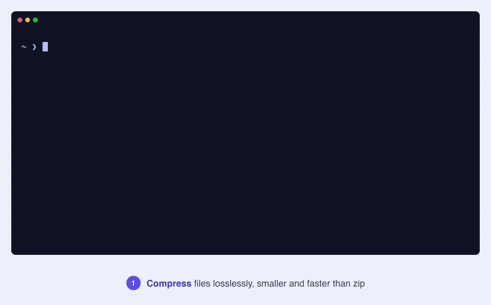

# vaqum

Losslessly compress files 5x faster and 12% smaller output than zip/gzip at defaults (optionally encrypted), decompress them, diff (displayed on editor or HTML report), search and find duplicates, and securely shred them — from the command line.

## Install

```bash
npm i -g @marcdomain/vaqum
```



This package is a thin wrapper around the native `vaqum` binary. The binary
for your platform comes from a small companion package (e.g.
`@marcdomain/vaqum-darwin-arm64`) that npm, pnpm, yarn and Bun pick
automatically. Install scripts aren't required.

If that package is skipped (`--omit=optional`, or a lockfile made on another
OS), the binary is downloaded from the npm registry instead, with the
[GitHub Release](https://github.com/marcdomain/vaqum/releases) as a backup,
and verified before use. This happens during install, or on first run if
install scripts are disabled.

Environment variables:

- `VAQUM_BINARY_PATH`: use this binary instead of the bundled one.
- `VAQUM_CACHE_DIR`: where a first-run download is cached.

## Usage

```sh
vaqum compress <path>... [-o out] [-l 1-22] [--max] [-r] [--dedup] [--exclude <pattern>] [--profile <name>] [-v] [-e] [--key-file <f>] [-q]
vaqum decompress <path.vaqum|.zip|.tar.gz> [-o dir] [--verify] [--key-file <f>] [--max-ratio <n>] [--force] [-q]
vaqum diff <a> <b> [--html report.html] [--open] [--editor]
vaqum dedupe <dir> [--link] [-q]
vaqum search <pattern> [path] [-i] [-E]
vaqum shred <path> [-r] [-p passes] [-y] [-q]
vaqum info <path>
vaqum completions <bash|zsh|fish|powershell|elvish> [--install]
vaqum config <show|path|init>
```

`compress` accepts multiple files/directories, bundled into one archive (`-o` required). `--exclude <pattern>` (repeatable, end with `/` for a directory) skips matching paths — also read from a `.vaqumignore` file at each directory's root.

`config` persists `compress` defaults and named profiles (`--profile <name>`) at `~/.config/vaqum/config.toml`; `config init` scaffolds one, `config show` prints what's resolved. CLI flags always win over a profile, which wins over the config file's defaults.

`info` also works on a plain file or directory (not just `.vaqum` archives), showing size, checksum, and timestamps.

`decompress`/`info` also read `.zip` and `.tar.gz`/`.tgz` (detected by content) as a convenience — read-only; vaqum's own format is the only supported output.

`completions --install` writes the completion script to that shell's standard user directory (auto-detected from `$SHELL` if omitted) instead of printing it.

A progress bar shows on `compress`/`decompress`/`dedupe`/`shred` in an interactive terminal; suppress it with `-q` or by piping output.

Run `vaqum <command> --help` for full flag documentation.

Full docs, source, and issues: <https://github.com/marcdomain/vaqum>
