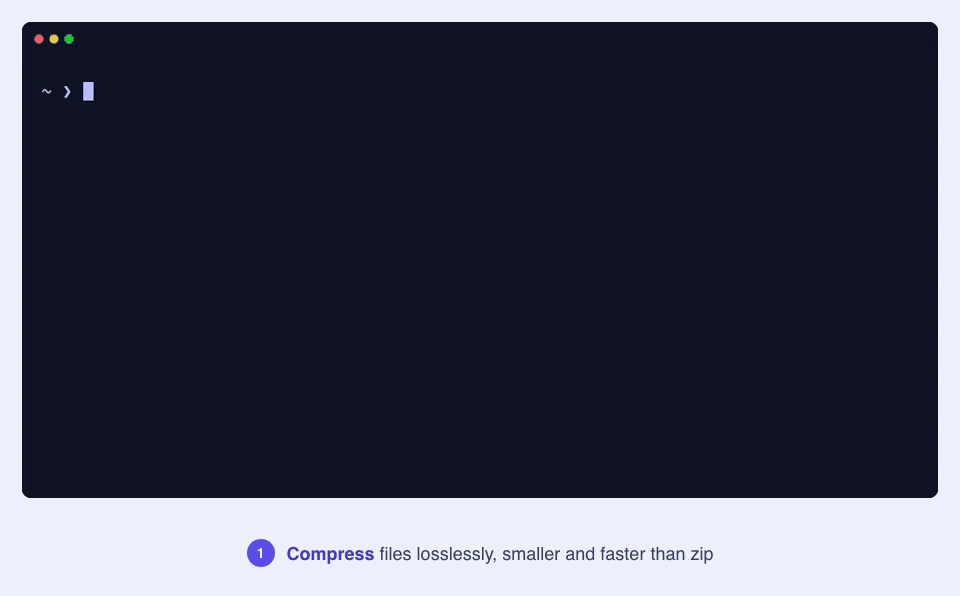

# vaqum Homebrew tap

Homebrew tap for [vaqum](https://github.com/marcdomain/vaqum) — Losslessly compress files faster and smaller than zip/gzip (optionally encrypted), decompress them, diff (displayed on editor or HTML report), search and find duplicates, and securely shred them — from the command line.



## Install

```sh
brew tap marcdomain/vaqum
brew install vaqum
```

Or in one line: `brew install marcdomain/vaqum/vaqum`.

## Usage

```sh
vaqum compress <path>... [-o out] [-l 1-22] [--max] [-r] [--dedup] [--exclude <pattern>] [--profile <name>] [-v] [-e] [--key-file <f>] [-q]
vaqum decompress <archive.vqm|.zip|.tar.gz|-> [-o dir|-] [--only <path>]... [--verify] [--key-file <f>] [--max-ratio <n>] [--force] [-q]
vaqum list <archive> [--json] [--key-file <f>]                    # alias: ls
vaqum diff <a> <b> [--html report.html] [--open] [--editor]
vaqum dedupe <dir> [--link] [-q]
vaqum search <pattern> [path] [-i] [-E]
vaqum shred <path> [-r] [-p passes] [-y] [-q]
vaqum info <path>
vaqum completions <bash|zsh|fish|powershell|elvish> [--install]
vaqum config <show|path|init>
```

`compress` accepts multiple files/directories, bundled into one archive (`-o` required). `--exclude <pattern>` (repeatable, end with `/` for a directory) skips matching paths — also read from a `.vaqumignore` file at each directory's root.

`config` persists `compress` defaults and named profiles (`--profile <name>`) at `~/.config/vaqum/config.toml`; `config init` scaffolds one, `config show` prints what's resolved. CLI flags always win over a profile, which wins over the config file's defaults.

`list` shows what's inside an archive without extracting it; `decompress --only <path>` (repeatable) extracts just those files or folders. Use `-` for stdin/stdout to pipe data through: `cat data.csv | vaqum compress - > data.vqm`, `vaqum decompress backup.vqm -o - | tar x`.

Archives use the `.vqm` extension; files from older versions named `.vaqum` still open (archives are detected by content, not name).

`info` also works on a plain file or directory (not just `.vqm` archives), showing size, checksum, and timestamps.

`decompress`/`info` also read `.zip` and `.tar.gz`/`.tgz` (detected by content) as a convenience — read-only; vaqum's own format is the only supported output.

`completions --install` writes the completion script to that shell's standard user directory (auto-detected from `$SHELL` if omitted) instead of printing it.

A progress bar shows on `compress`/`decompress`/`dedupe`/`shred` in an interactive terminal; suppress it with `-q` or by piping output.

Run `vaqum <command> --help` for full flag documentation.

Full docs, source, and issues: <https://github.com/marcdomain/vaqum>
